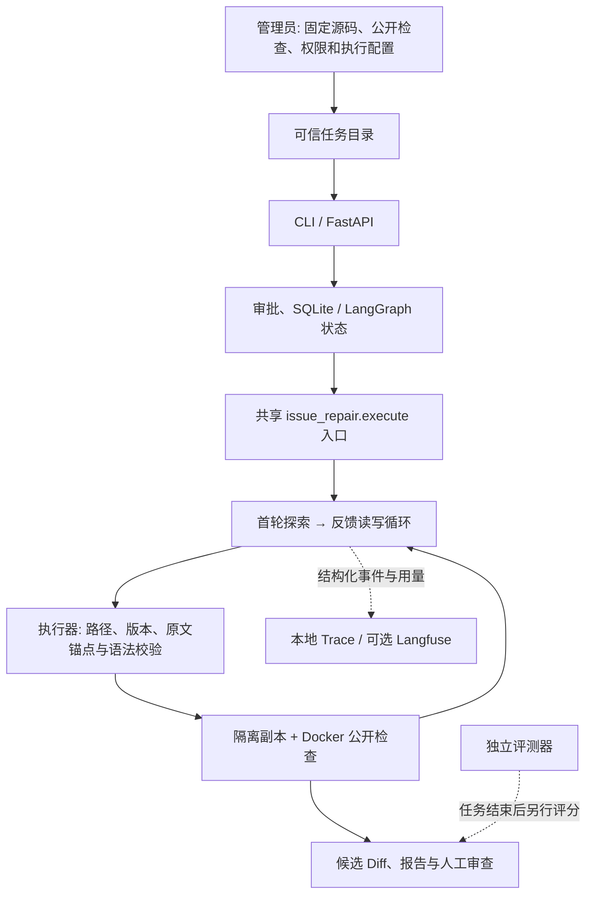

# Issue 反馈修复服务

本阶段交付一个本地可运行、可演示的版本，不继续扩大准确率实验。`feedback-actions-v2` 通过 CLI/API 共用入口执行“首轮探索 → 公开失败反馈 → 再读取/修改/验证”，复用已有审批与任务服务。只支持管理员登记、固定版本和权限的 Python 任务；不自动提交 Git、发布 PR 或合并补丁。

公开检查通过后返回 `ready_for_review`。产品报告始终为 `accepted=false`、`independent_verification.available=false`；独立评测器和隐藏检查不进入服务执行进程。

## 架构与执行边界



模型或录制响应只提出结构化动作，执行器实际读写、运行检查。反馈工具包括 `list_files`、`search`、`read_file`、`read_symbol`、`apply_patch` 和 `finish`，只覆盖任务明确允许的文件；只读依赖不会因被读取而变为可写。补丁使用唯一原文锚点，不按行号覆盖。原始准备目录保留，修改发生在任务副本。

主要实现：[共享入口](../repairflow/issue_repair.py)、[反馈适配层](../repairflow/issue_feedback.py)、[执行配置](../repairflow/issue_execution.py)、[任务注册](../repairflow/issue_registry.py)、[服务适配](../service/issues.py)。

## 最短演示：无需模型和外部下载

前提是已有 corecoder Conda 环境及 service/workflow/dev 依赖、可用的 Docker Linux 引擎和本地 `corecoder-test-sandbox:v1` 镜像。已有环境可直接使用；本命令不安装依赖、不下载镜像、不启动 Ollama，也不访问 GitHub。镜像和 Docker 数据盘位置仍由本机 Docker 配置决定，须已放在 D 盘。

在 PowerShell 中执行，所有新增输出及临时文件放 D 盘：

```powershell
Set-Location D:\project_other\CoreCoder
$env:PYTHONDONTWRITEBYTECODE='1'
$env:PYTHON_DOTENV_DISABLED='1'
$env:PYTHONIOENCODING='utf-8'
$env:CORECODER_LANGFUSE_ENABLED='0'
$env:PYTHONPATH='D:\project_other\CoreCoder;D:\project_other\CoreCoder\.tmp\workflow-deps;D:\project_other\CoreCoder\.tmp\langfuse-deps'
$env:TEMP='D:\project_other\CoreCoder\.tmp\python-temp'
$env:TMP=$env:TEMP
New-Item -ItemType Directory -Force $env:TEMP | Out-Null
python -B -m repairflow demo-feedback --output .tmp/feedback-demo-001
```

目录必须全新；再次演示改用 `feedback-demo-002`，不要覆盖旧证据。可用 `--image <现存镜像标识>` 指定镜像；准入、注册及运行期间的实际镜像身份必须一致，标签指向发生变化时会拒绝执行。演示通过 ASGI 客户端驱动真实应用与 Worker，不额外监听端口，不占用已有 8001 服务或服务数据目录。

任务由 [issue_demo_fixture](../repairflow/issue_demo_fixture.py) 自包含生成。Issue 身份和 commit 是合成夹具，内存客户端提供源码 ZIP 和公开信息；`fixture-manifest.json` 明确标记合成来源、外部请求 0、真实模型调用 0。它不是从真实 GitHub Issue 下载的任务，也不是旧 50 项任务池的成绩。

六条录制响应先结束首轮探索，再读取目标函数、提交一个错误修改、读取只读依赖并重读目标，最后提交正确候选。每次有效编辑后真实运行公开检查，复现检查依次失败、失败、通过，保持检查持续通过。CLI 和 API 各执行同一录制序列。

`demo/acceptance.json` 同时核对：

- CLI/API 最终 Diff 和公开结果一致。
- 审批前零执行；等待审批时重建服务，审批状态恢复。
- 同一幂等键返回同一任务；重复批准不再次执行；拒绝审批则不执行。
- SSE 和白名单制品可读取；真实模型调用为 0，独立验收仍为 false。

`status=passed` 只表示工程演示通过。`scripted_calls` 是录制响应消费数，不是实际模型调用数。

## 在浏览器中操作同一任务

演示生成的 `inputs/catalog/sample` 已注册新执行策略。需要手动查看 Swagger 时，另开终端，沿用上述环境，在未被占用的端口与全新服务目录启动：

```powershell
$env:CORECODER_ISSUE_TASKS='D:\project_other\CoreCoder\.tmp\feedback-demo-001\inputs\catalog'
python -B -m service --port 8004 --timeout 2520 --output .tmp/feedback-http-001
```

打开 `http://127.0.0.1:8004/docs`，先查 `GET /catalog`，再提交：

```json
{"suite":"issues","task_id":"sample","mode":"scripted","workflow":"issue-approval-v1"}
```

`POST /tasks` 携带 `Idempotency-Key`。等待 `awaiting_approval` 后，读取 `GET /tasks/{id}/artifacts/workflow.json` 的审批计划，再向 `POST /tasks/{id}/approval` 提交 `{"decision":"approve"}` 或 `{"decision":"reject"}`。API 的工作流名保持 `issue-approval-v1`，实际 engine 由可信目录固定。

| 接口 | 作用 |
| --- | --- |
| `GET /tasks/{id}` | 查看状态；不能只根据模型回复判断完成 |
| `GET /tasks/{id}/events` | SSE 生命周期事件，支持 Last-Event-ID |
| `POST /tasks/{id}/cancel` | 取消任务并清理所属 Worker/容器 |
| `GET /tasks/{id}/artifacts/{name}` | 下载已有的白名单制品 |

客户端只能提交可信任务 ID 和允许模式，不能上传任意路径、Shell、检查、模型配置或执行上限。服务是本地单实例原型，不提供多租户认证或分布式调度。

## 登记已有准入任务

真实任务先按[准备指南](github-issue-preparation.md)导入、固定源码并完成 Docker 准入。管理员可用下列注册命令；这里的准备目录、配置和输出名按实际任务替换：

```powershell
python -B -m repairflow register-issue --prepared .tmp/issue-prepared/task-001 --config configs/issue-tasks/task.json --output .tmp/issue-tasks/task-001 --engine feedback-actions-v2 --execution-profile profile.json
```

服务读取注册时复制并校验哈希的配置，审批绑定 engine、输入、模型、权限和限制；等待期间替换内容会被拒绝。旧目录不自动升级：旧注册默认仍为 `symbol-recovery-v1`。脚本演示可由管理员额外登记 `--responses <录制文件>`；没有录制文件的条目只允许 API `mode=live`。

CLI 也可对已准入任务使用 `repair-issue --workflow feedback-actions-v2 --execution-profile profile.json`，其 `--mode` 为 `scripted` 或 `ollama`；脚本模式还需 `--responses`。真实本地模式使用已安装 Ollama 模型、thinking=false；它会产生新的推理，本阶段验收不要求运行，也不使用 DeepSeek API。

## 轮次、时间与 Token 的实际含义

默认执行配置只有下列五个正整数，管理员修改后需重新登记并审批：

```json
{
  "exploration_requests": 20,
  "feedback_requests": 20,
  "exploration_seconds": 1200,
  "feedback_seconds": 1200,
  "context_target_tokens": 12000
}
```

反馈的 20 次是请求总数，包含读取、无效动作和编辑，不是保证 20 次有效修复。首轮探索还保留最多 6 次编辑尝试及重复/错误停止规则；反馈阶段没有重复读取提前停止。读写白名单、Schema、原文证据、版本及语法校验继续生效。

新策略不设置累计 Token 或输出 Token 截止，实际用量照常计量；单次请求最长 480 秒、Provider 上下文容量 65,536。12,000 是反馈上下文估算目标，不是费用上限，也不能证明服务端完整接收了输入。该策略只支持 `observation_policy=full`，不能静默套用旧 `compact-v1`。

两阶段共用总截止时间，各阶段另受自己的时间上限约束。服务默认总超时仍是 240 秒；实际执行取管理员服务上限和阶段预算的较小范围，并预留 5 秒退出，审批及报告记录 `effective_limits`。上面的专用演示服务显式给出 2520 秒，不会全局放宽其他任务的超时。

## 状态与制品

| 结果 | 含义 |
| --- | --- |
| `ready_for_review` | 有非空候选、原始输入未变、公开检查通过；仍需人工审查 |
| `failed` | 未解决、请求耗尽、输入/工具/运行错误等；查看报告具体原因 |
| `rejected` | 执行审批被拒绝，没有启动修复 |
| `cancelled` / `timed_out` / `interrupted` | 执行未正常交付，已有候选不得视为验证成功 |

服务重启会恢复待审批任务；已运行中断的任务保留为 `interrupted`，不自动重放模型请求或副作用。取消、超时清理使用可信任务根目录归属，不清理其他服务的容器。

演示目录结构：

```text
feedback-demo-001/
  inputs/                 合成源码、公开检查、录制响应和可信目录
  demo/cli/               CLI 执行报告；initial/、feedback/ 保存阶段细节
  demo/api/               API 任务、审批数据库与 Worker 产物
  demo/evidence/          经 API 下载的制品及 events.sse
  demo/acceptance.json    演示核对结果
```

新策略顶层固定产物为 `report.json`、`patch.diff`、`actions.json`、`trace.jsonl`、`provenance.json`、`context-selection.json`、`observability.json`。分别记录公开结果/限制/用量、候选、动作、事件、输入与实现哈希、上下文选择及观测状态。API 另保留审批 `workflow.json`；不提供录制答案、任意路径或数据库下载。

失败、取消、超时、中断允许下载已经完整写入的白名单产物；尚未产生的文件返回 404。服务提供的中断报告视图会清除交付/公开通过声明、标明当前生命周期，磁盘原始记录保持不变。已有 `patch.diff` 只是待核查候选，不能套用上一次通过结果。

## Langfuse 与验收证据

默认关闭观测；按 [Langfuse 指南](langfuse-local.md)设置 `CORECODER_LANGFUSE_ENABLED=1` 及本地连接文件，再运行新目录的演示。录制响应使用普通 Span，不伪装为 Generation，用量标记不适用；真实调用缺少原生计数时标记未知，不能将未测量值冒充实测零 Token。Langfuse 记录过程和成本，不替代公开检查或独立评分。

`observability.json` 的链接或 `submitted_unconfirmed` 只说明已尝试提交，须回读服务器确认落库。观测失败不丢弃本地任务报告。不要为了展示 Trace 重跑旧 50 项模型实验。

真实 Docker 验收覆盖完整修正、请求耗尽、运行取消和反馈截止。最终回归数量、命令、镜像身份与完整证据清单以[本阶段验收记录](engineering-closeout-20261112.md)为准；历次运行和修正记录保留，不把分批测试合并成一次全量测试。

公开命令 `python -B -m repairflow demo-feedback` 已于 2026-11-12 完成全新运行，退出码 0；证据为 `.tmp/engineering-closeout-20261112/product-demo/demo/acceptance.json`。CLI/API 同 Diff，审批重启、幂等、重复批准及拒绝执行核对通过；反馈消费 5 次请求、3 次读取、2 次有效编辑，真实执行 3 轮公开验证，完整修正链路通过。真实模型调用 0，`independent_acceptance=false`。

同日启用 Langfuse 的演示已通过真实服务端回读：两条 Trace 各有 15 个完整节点，其中各 6 个录制响应 Span、0 个 Generation；节点树、数量、结束状态、摘要范围及评分均已核对。收据为 `.tmp/engineering-closeout-20261112/langfuse-product-demo-receipt.json`，不是仅凭链接或 flush 宣布完成。后续最终运行与版本冻结以[本阶段验收记录](engineering-closeout-20261112.md)为准。

当前模型能力限制仍保留：[五项本地 Qwen 验收](feedback-pilot-20261109.md)为 **1/5** 独立通过，125 次调用、692,438 Token，四项主要停在重复读取而未提交反馈补丁；不能与旧 DeepSeek **47/50** 计算因果提升。本次合成工程演示不改变这两组成绩。

阶段范围与冻结条件见[工程收尾方案](engineering-closeout-plan-20261112.md)：接通共享执行、状态/清理/制品与演示后结束本阶段；不以修好四个失败任务、扩权 Harness² 或再接框架作为收尾条件。
